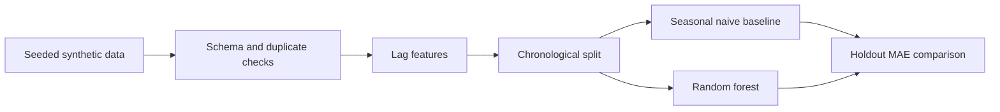

# Synthetic Sales Forecasting

A small, reproducible **synthetic reconstruction** of a sales-forecasting workflow. Loutchiana Marie's final-year project used real ERP sales data; that original data, source files, customer names, and screenshots are **not** included here. This new portfolio example was prepared with Codex assistance in October 2026 to demonstrate data validation, time-aware features, a baseline, and a model comparison without disclosing employer information.

## Problem and approach

Monthly demand forecasts can support replenishment planning. This example generates fictional sales units for four anonymous product groups, builds one- and twelve-month lag features, and compares a seasonal naive baseline with a random forest. The last six months are held out. Evaluation is **rolling one-step ahead**: historical actuals from earlier holdout months are available for later predictions. It is not a six-month recursive forecast.



## Run

Python 3.11+ is required.

```bash
git clone https://github.com/loutchianamarie/synthetic-sales-forecasting.git
cd synthetic-sales-forecasting
python -m venv .venv
# Linux/macOS: source .venv/bin/activate
# Windows PowerShell: .venv\Scripts\Activate.ps1
python -m pip install -e '.[dev]'
python -m synthetic_forecasting generate
python -m synthetic_forecasting evaluate
ruff check src tests
python -m pytest -q
```

Generated CSV output goes to ignored `output/synthetic_sales.csv`. The evaluation command prints the holdout cutoff, row counts, and MAE for both methods. Results on generated data do **not** establish performance on real sales data.

With seed 42 and the last six months held out (24 product-month rows), the local run produced:

| Method | MAE in generated units |
| --- | ---: |
| Seasonal naive (`lag_12`) | 10.799 |
| Random forest | 5.318 |

These are measurements on the repository's deterministic synthetic data, not results from the original final-year project.

## Data dictionary

| Field | Meaning |
| --- | --- |
| `month` | First day of the fictional sales month. |
| `product_group` | Anonymous group A-D. |
| `units` | Generated nonnegative units sold. |

The generator uses a deterministic seed, linear trend, seasonal cycle, and random noise. There is no customer, employer, product, or financial data in the repository.

## Design choices and limits

- The baseline makes model value visible; a complex model should beat a simple alternative before being adopted.
- The split is chronological, and lag features use prior observations. No random split is used.
- MAE is in generated units. There are no production metrics, dashboard, deployment, or claims about business impact.
- The original final-year work compared additional methods and used a dashboard; this safe reconstruction implements a smaller, reviewable subset. It is not a release of the original project.
- A real forecasting system would need holidays, promotions, stockouts, returns, demand changes, uncertainty intervals, and retraining controls.

## Project context

Prepared for [Loutchiana Marie's portfolio](https://github.com/loutchianamarie) with Codex assistance. The code and dataset in this repository are newly created and synthetic.
